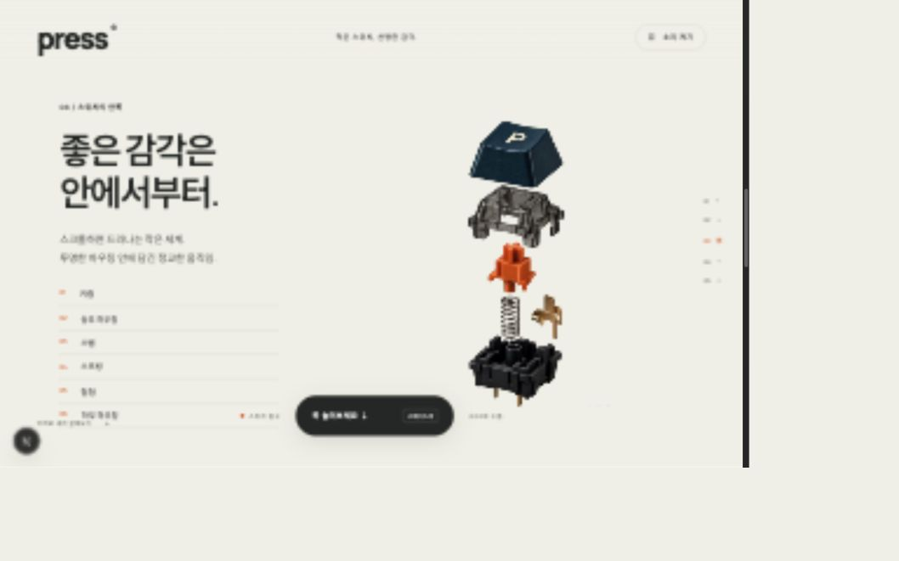

# PRESS

기계식 키보드 스위치의 움직임과 구조를 살펴보는 인터랙티브 웹사이트입니다.

키캡을 누르고, 스크롤하면서 스위치를 분해하고 다시 조립할 수 있습니다. 작은 부품 하나를 크게 보여주고, 짧은 움직임에 집중하는 제품 소개 페이지로 만들었습니다.



## 인터랙션

- **스크롤**: 첫 번째부터 세 번째 섹션까지 스위치가 작아지며 분해되고, 세 번째부터 다섯 번째 섹션까지 다시 커지며 조립됩니다.
- **키캡 누르기**: 하단 버튼을 길게 누르거나 스페이스바를 누르면 조립 상태에서 키캡만 내려갑니다. 마우스와 터치 모두 지원합니다.
- **사운드**: 소리를 켜면 누를 때 짧은 합성 타건음이 재생됩니다. 기본값은 음소거입니다.
- **설계도 보기**: 현재 프레임의 윤곽선을 추출해 내부 구조를 선으로 살펴볼 수 있습니다.
- **모바일**: 설명 길이에 맞춰 제품 위치와 크기를 조절하고, 중간 섹션에서는 제품을 오른쪽으로 옮겨 글과 겹치는 부분을 줄였습니다.

## 구현 방식

제품은 Canvas 2D에 그립니다. AI로 만든 제품 이미지와 분해 영상을 바탕으로, 영상에서 추출한 WebP 96장을 스크롤 위치에 연결했습니다. 실시간 3D 모델을 회전시키는 방식과는 다릅니다.

스크롤을 되돌리면 같은 프레임을 역순으로 사용합니다. 프레임 사이를 흐리게 섞지 않고, 스크롤 진행값을 부드럽게 따라가도록 처리했습니다. 키캡을 누르는 동작은 첫 프레임에서 키캡과 본체를 분리해 그립니다.

프레임 파일을 미리 가져오되, 디코딩한 이미지는 최대 14장만 유지합니다. 아직 준비되지 않은 프레임은 가장 가까운 이미지로 대신 표시하고, 화면을 벗어난 이미지 메모리는 해제합니다. 동작 줄이기 설정을 사용하면 스크롤 보간과 커서에 따른 움직임을 줄입니다.

## 기술

Next.js 16 · React 19 · TypeScript · Canvas 2D · Web Audio API · CSS

## 다운로드

[프로젝트 ZIP 다운로드](https://github.com/Kbomi/works-press/archive/refs/heads/main.zip)

GitHub 저장소에서 **Code → Download ZIP**을 눌러도 됩니다. 압축을 푼 폴더에서 아래의 로컬 실행 명령을 실행하세요. Node.js가 설치되어 있어야 하며, 파일을 더블클릭하는 방식으로는 실행되지 않습니다.

Git을 사용한다면:

```bash
git clone https://github.com/Kbomi/works-press.git
cd works-press
npm ci
npm run dev
```

실행 후 [http://127.0.0.1:4320/works/press/](http://127.0.0.1:4320/works/press/)에 접속하세요.

## 로컬 실행

Node.js 20.9 이상과 npm이 필요합니다.

```bash
npm ci
npm run dev
```

접속 주소: [http://127.0.0.1:4320/works/press/](http://127.0.0.1:4320/works/press/)

현재 프로젝트에는 `/works/press` 배포 경로가 설정돼 있습니다. 루트 주소 `/` 대신 위 주소로 접속하세요.

## 프로젝트 구조

```text
app/
  page.tsx                    섹션 구성, 입력 처리, 사운드
  layout.tsx                  페이지 메타데이터와 공통 레이아웃
  globals.css                 화면 스타일과 반응형 배치
components/
  ProductScene.tsx            프레임 로딩과 캔버스 렌더링
public/sequences/
  switch-vidu-v1/
    frame-001.webp ~ 096.webp 제품 이미지 시퀀스
    manifest.json            원본 시간과 키캡 위치 정보
docs/
  preview.png                 프로젝트 미리보기
next.config.ts                정적 내보내기와 배포 경로
```

## 수정할 때

| 수정할 내용                            | 파일                          |
| -------------------------------------- | ----------------------------- |
| 제목, 본문, 사양, 버튼 문구            | `app/page.tsx`                |
| 색상, 글꼴, 반응형 스타일              | `app/globals.css`             |
| 스크롤에 따른 크기와 위치, 프레임 로딩 | `components/ProductScene.tsx` |
| 페이지 제목과 검색 설명                | `app/layout.tsx`              |
| 배포 경로                              | `next.config.ts`              |

프레임을 교체한다면 `ProductScene.tsx`의 프레임 수·크기·파일 경로와 `manifest.json`의 위치 정보도 함께 맞춰야 합니다. 현재 프레임은 잘린 키캡을 보완하고 위아래 여백을 더한 이미지라, 새 영상의 이미지를 그대로 덮어쓰면 배치가 어긋날 수 있습니다.

## 확인과 빌드

```bash
npm run typecheck
npm run build
```

빌드하면 정적 배포용 파일이 `out/`에 생성됩니다. `out/` 안의 파일을 정적 호스팅에 업로드합니다. 현재 설정에서는 `/works/press/` 경로로 제공해야 합니다.

로컬에서 배포 파일을 확인하려면:

```bash
mkdir -p /tmp/press-preview/works/press
cp -R out/. /tmp/press-preview/works/press/
python3 -m http.server 4321 --bind 127.0.0.1 --directory /tmp/press-preview
```

[http://127.0.0.1:4321/works/press/](http://127.0.0.1:4321/works/press/)에서 확인할 수 있습니다. 이 예시는 macOS·Linux와 Python 3 기준입니다. 정적 내보내기를 사용하므로 `next start` 대신 정적 파일 서버를 사용합니다.

다른 경로에 배포하려면 `next.config.ts`의 `basePath`와 `ProductScene.tsx`의 `frameUrl`을 함께 수정한 뒤 다시 빌드하세요. 루트 배포는 `basePath`를 제거하고 프레임 주소를 `/sequences/...`로 변경합니다. GitHub Pages의 프로젝트 저장소 주소를 쓴다면 두 경로를 저장소 이름에 맞춰야 합니다.

## 에셋과 표현 범위

제품 이미지와 영상에는 AI 생성 도구를 사용했고, 최종 시퀀스는 Vidu 영상에서 추출했습니다. 원본에서 화면 밖으로 나간 키캡은 같은 영상의 정상 프레임을 바탕으로 보완했습니다. 프레임에 포함된 원본 워터마크는 유지했습니다.

제품 사양은 컨셉을 위한 설정값입니다. 설계도 모드는 이미지의 윤곽선 효과이며 실제 CAD 도면이 아닙니다. 이미지·영상 에셋을 다른 작업에 재사용할 때는 생성 서비스의 이용 조건을 확인해 주세요.
